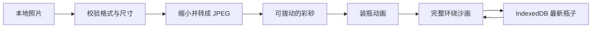

# 技术设计

砂藏是一份静态网页。Vite 打包 TypeScript 与 Three.js，GitHub Actions 构建并发布到 GitHub Pages。运行时资源随站点提供，不依赖字体或渲染库 CDN。

## 数据与流程

`BottleDraft` 只包含规范化照片、瓶子标题、颜色方案、接缝宽度、创建时间和数据版本。它不包含 Three.js 对象、相机或手势状态。

应用负责 loading、loose、assembling、sealed 和 failure 状态。保存结果单独记录，保存失败不阻断观看。新操作会取消旧的异步操作，避免较慢的图片解码覆盖后选的照片。

## 环绕照片

松散态按原 demo 的 1.9 像素间隔抖动采样。大部分颗粒绘成 2×2 像素，其中一角稍亮。松散态保留粒子位置，拨动后重绘到 CanvasTexture。

装瓶态单独表达压实后的砂面。先画细砂底层，再画尺度略大的可辨认颗粒。每粒砂用一个紧凑的不规则外轮廓、倾斜顶面和边缘斜面表达。局部长宽缩放后再整体旋转，避免拉伸方向固定在纹理横纵轴。颜色图保存局部照片颜色与接触遮蔽，法线图保存各面的倾斜方向，让切面随瓶子转动接受场景光照。它仍是砂体上的材质，没有给每粒砂建立独立模型。颗粒之间填充相应位置较暗的照片颜色，避免漏出全局黑底。纹理中的颗粒覆盖多个像素，让缩小显示后仍有完整形体。粗糙材质受场景光照影响，圆弧两侧形成明暗。封闭的砂体沿内壁延伸到瓶肩和瓶颈，图像保留在直身区域，肩颈填充与照片留白相同的沙色。UV 以实际高度分配，照片按身体区域的周长和高度等比容纳。

照片只环绕一圈，接缝在背面。不透明砂体遮住背面，避免前后照片叠在一起。照片保持原比例，余下区域补沙色。保存的原图与显示颗粒层分离，换色不会反复损失原图质量。

装瓶使用少量活动粒子表现收拢，上升的裁切面和顶盖表现砂体逐渐填满。相机从松散画面的视角过渡到抬高的装瓶视角，让瓶塞顶面、瓶肩和瓶底采用同一个透视投影。玻璃采用本地 HDR 环境反射和透明 Fresnel 轮廓叠层，以保持照片清晰度。没有模拟物理折射或每粒沙子的真实碰撞。实物依据见 [视觉参考](visual-references.md)。

## 照片边界

只接受 JPG、PNG、WebP，文件不超过 15 MiB，解码尺寸不超过 3200 万像素。长边缩至最多 1536 像素，透明区域铺暖沙色。保存的 JPEG data URL 上限为 4 MiB。恢复数据时重新校验格式、字段与图像尺寸。

## 本地保存

IndexedDB 保存一条最新完成的瓶子记录。写入与清除按调用顺序执行。预览新照片不应覆盖已经完成的瓶子；装瓶成功后才写入新记录。浏览器禁用存储时给出提示，制作和观看仍可继续。

## 维护边界

`scene.ts` 拥有 GPU 资源、旋转与粒子动画；`app.ts` 拥有页面与制作流程；`photo.ts` 拥有图片边界；`persistence.ts` 拥有数据库边界。销毁场景时释放监听器、观察器、动画帧、纹理、几何体与材质。砂面材质通过自身的 dispose 事件释放法线贴图，颜色贴图沿用内容释放路径。

新增功能应优先维持照片清晰度、单一瓶子流程与纯静态部署。下载、跨设备分享和全物理沙粒不属于本版本。
