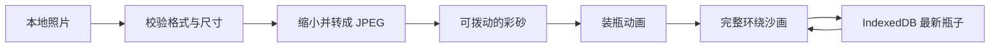

# 技术设计

砂藏是一份静态网页。Vite 打包 TypeScript 与 Three.js，GitHub Actions 构建并发布到 GitHub Pages。运行时资源随站点提供，不依赖字体或渲染库 CDN。

## 数据与流程

`BottleDraft` 包含规范化照片、兼容旧记录的标题字段、颜色方案、接缝宽度、创建时间和数据版本。界面不再提供命名或接缝设置，新记录的标题为空；旧的原色记录统一按暖调读取。原有接缝宽度继续保存在记录里。它不包含 Three.js 对象、相机或手势状态。

应用负责 loading、loose、pouring、assembling、sealed 和 failure 状态。保存结果单独记录，保存失败不阻断观看。新操作会取消旧的异步操作，避免较慢的图片解码覆盖后选的照片。

## 环绕照片

松散态按原 demo 的 1.9 像素间隔抖动采样。大部分颗粒绘成 2×2 像素，其中一角稍亮。松散态保留粒子位置，拨动后直接重绘原生 720×432 Canvas2D。画框保持正面矩形，不经过瓶子相机。

装瓶态单独表达压实后的砂面。先画细砂底层，再画尺度略大的可辨认颗粒。每粒砂用一个紧凑的不规则外轮廓、倾斜顶面和边缘斜面表达。局部长宽缩放后再整体旋转，避免拉伸方向固定在纹理横纵轴。颜色图保存局部照片颜色与接触遮蔽，法线图保存各面的倾斜方向，让切面随瓶子转动接受场景光照。它仍是砂体上的材质，没有给每粒砂建立独立模型。颗粒之间填充相应位置较暗的照片颜色，避免漏出全局黑底。纹理中的颗粒覆盖多个像素，让缩小显示后仍有完整形体。粗糙材质受场景光照影响，圆弧两侧形成明暗。封闭的砂体沿内壁延伸到瓶肩和瓶颈，图像保留在直身区域，肩颈填充与照片留白相同的沙色。UV 以实际高度分配，照片按身体区域的周长和高度等比容纳。

照片只环绕一圈，接缝在背面。不透明砂体遮住背面，避免前后照片叠在一起。照片保持原比例，余下区域补沙色。保存的原图与显示颗粒层分离，重复制作不会反复处理已生成的颗粒纹理。

场景只维护一条动画时钟。倒出保留原有临时瓶内粒子与平面落砂时序，单独计算整瓶倾倒姿态。照片的局部 Y 轴旋转与世界 Z 轴倾倒通过四元数相乘，先应用照片旋转，再应用整瓶倾倒。临时画框先缩小并放到瓶口下方。瓶口朝下并定位完成后才开始落沙。倒出计划为每粒沙分配固定的小股出沙时间、轻微横向分离、入射速度与落地时间。每小股之间保留真实出沙间隔。屏幕沙流固定抽样同一批代表颗粒，不按帧随机隐藏。颗粒向下加速，落到各自的局部沙堆高度，短暂停留后分两小段向原图位置滑动。照片的扩展顺序按椭圆距离并加入不规则边缘，避免整齐的三角形揭幕。出瓶、飞行和堆积共用一份事件，原生画布在结束前到达准确原图位置。整个姿态保持到最后一粒落地，随后画框展开。完成、取消与减少动态效果都会恢复纯 Y 轴旋转。装瓶时画框缩小、抬起并顺时针倾斜 28 度，出口保持在瓶口上方。原生画布与屏幕沙流共用变换后的角点，越过木框后向下落入真实投影瓶口，不使用旋转后的轴对齐包围盒定位。

装瓶余沙按倾斜画框内的累计面积坐标移动。每粒保留起始位置在等高线上的横向位置，扣除共同的已排面积后求出新位置。沙堆逐渐缩向角落，同时保留二维面积，不在一条边上重叠等待。离框、过瓶口和落地时间属于同一份计划。瓶内压实沙量按已经落地的颗粒累计计算，空中细沙仅存在于过瓶口到落地期间。

装瓶的沉积表面克隆已认可砂面的受光材质，共享原有颜色图、法线图和不可变侧面几何。UV 不随填充拉伸。体积积分给出填充高度，小圆锥与细小波纹构成受光的堆积顶面。侧面边界与顶面使用同一高度函数，临时裁剪平面随瓶子变换到世界坐标。完成和取消只隐藏或释放临时对象，不改动静止砂面的材质和裁剪平面。临时对象释放自己的材质和顶面几何，不释放共享纹理。

装瓶仍为 4000ms。默认完整画面的最后一批沙约 3240ms 离框、3300ms 过瓶口、3400ms 落地、3440ms 稳定，瓶子从 3560ms 开始归位。倒出仍为 2900ms。瓶子相机保持封瓶视角，画框静止时仍是正面矩形。玻璃使用本地 HDR 环境反射和透明 Fresnel 轮廓叠层。没有模拟物理折射或每粒沙子的真实碰撞。实物依据见 [视觉参考](visual-references.md)。

## 照片边界

只接受 JPG、PNG、WebP，文件不超过 15 MiB，解码尺寸不超过 3200 万像素。长边缩至最多 1536 像素，透明区域铺暖沙色。保存的 JPEG data URL 上限为 4 MiB。恢复数据时重新校验格式、字段与图像尺寸。

## 本地保存

IndexedDB 保存一条最新完成的瓶子记录。写入与清除按调用顺序执行。预览新照片不应覆盖已经完成的瓶子；装瓶成功后才写入新记录。浏览器禁用存储时给出提示，制作和观看仍可继续。

## 维护边界

`scene.ts` 拥有 GPU 资源、旋转、单一切换时钟及结束清理；`sand-motion.ts` 拥有迁移时序与装瓶余沙面积；`sand-reservoir.ts` 拥有临时瓶内颗粒、沉积表面及其资源；`loose-sand.ts` 拥有平面颗粒与拨沙交互；`sand-transfer.ts` 拥有屏幕沙流；`app.ts` 拥有页面与制作流程；`photo.ts` 拥有图片边界；`persistence.ts` 拥有数据库边界。销毁场景时释放监听器、观察器、动画帧、纹理、几何体与材质。砂面材质通过自身的 dispose 事件释放法线贴图，颜色贴图沿用内容释放路径。

新增功能应优先维持照片清晰度、单一瓶子流程与纯静态部署。下载、跨设备分享和全物理沙粒不属于本版本。

## 操作界面

标题为“把回忆装进沙子里”。瓶子仅保留拖动与方向键旋转，平面画布默认拨沙。两个完成态共用画面底部中央的手势提示，转场时隐藏。“复原”为描边按钮，位于“装进瓶子”旁边；“换回示例”保留在画面下方。540px 以下的窄屏把两个制作按钮单独成行。平面提示为“轻轻拨动，玩一会儿沙”。画框宽度同时受舞台可用高度约束，框底与提示至少留出 20px。旋转按钮、漩涡切换、接缝控件和本地处理页脚已删除。本地保存和照片处理仍按原有边界运行。
